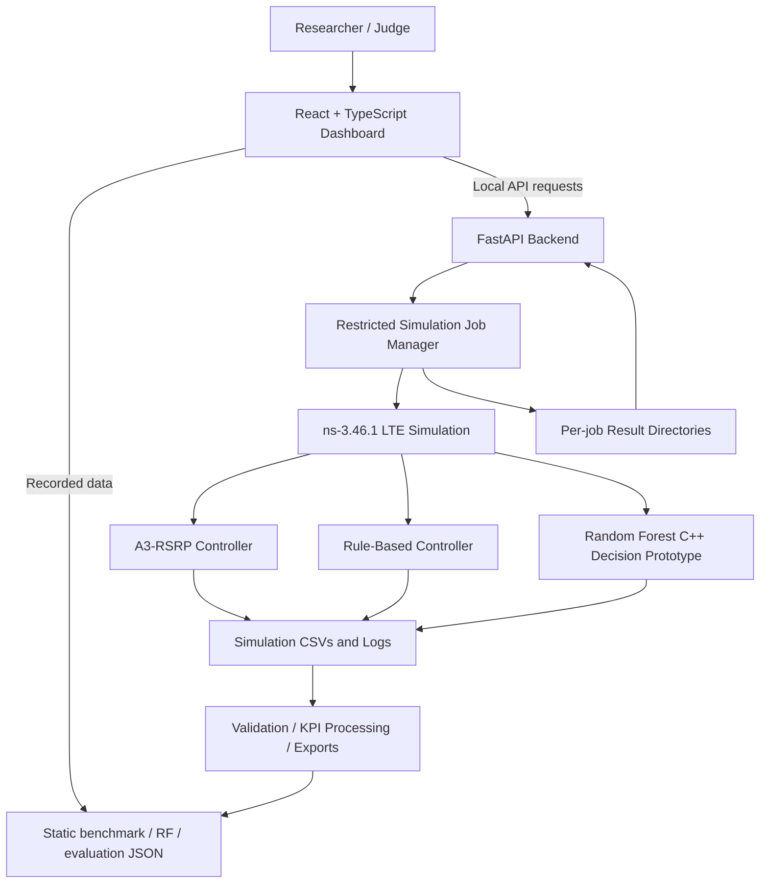
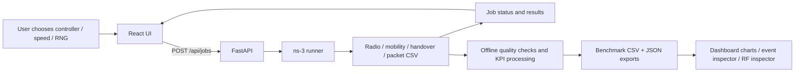
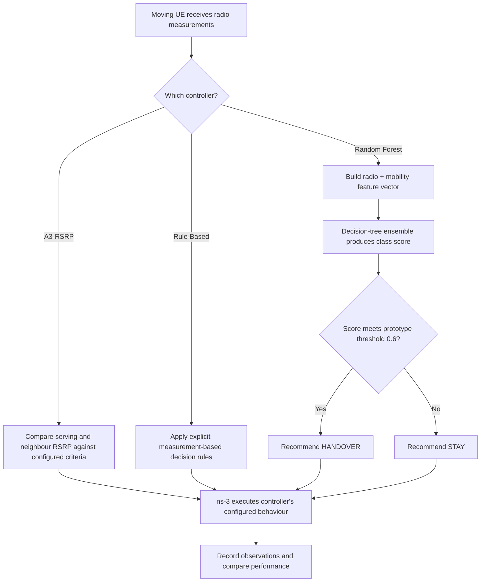

<div align="center">

# MOBI-HO Lab

### Reproducible Cellular Handover Benchmarking with ns-3 LTE and Machine-Learning Integration

**AIORI-3 Hackathon · Track 4: 6G & Future Networks · Problem Statement PS-016**  
**Team: A3-PS016-TC012**

[](https://mobi-ho-lab.vercel.app)
[](https://www.nsnam.org/)
[](frontend/)
[](backend/)

**🎬 [WATCH FINAL PROTOTYPE DEMONSTRATION](https://youtu.be/zuqGKWOaUuM)**  
**[Explore the public dashboard](https://mobi-ho-lab.vercel.app)** · **[Level 1 proposal video](https://youtu.be/p6eitYqHq6Y)** · **[Level 1 proposal PDF](A3-PS016-TC012.pdf)**

</div>

> **Deployment distinction:** The public Vercel website is a *recorded-data demonstration*. New ns-3 simulation jobs can be executed from the locally running full-stack dashboard; a public simulation server has not been deployed. The machine-learning model is an **integration prototype**, not an independently validated production controller.

## 1. Overview

**MOBI-HO Lab** is an end-to-end experimental environment for benchmarking cellular handover decisions under reproducible mobility conditions. It combines an **ns-3 LTE simulator**, three handover-controller approaches, structured trace processing, a **FastAPI simulation-job API**, and an interactive **React dashboard**.

In a cellular network, a moving user equipment (UE) may need to transition from one base station (eNB) to another. Poorly timed or unnecessary handovers can affect traffic continuity and network signaling. MOBI-HO Lab addresses a specific research and engineering need: **evaluate multiple handover approaches against comparable simulations, expose the measurements, and make the results inspectable.**

This repository focuses exclusively on **the PS-016 cellular handover benchmarking challenge**; it does not implement an unrelated home-broadband networking scenario.


### The problem in plain language

Imagine a phone on a moving train. It begins connected to **Cell 1** and needs to switch to **Cell 2** as signal conditions change. A handover decision made too late may degrade reception; one made prematurely may create unnecessary switching. Engineers need more than a claim that an algorithm is intelligent: they need **repeatable tests** that show what the algorithm decided, when it acted, and how data reception behaved.

### Our solution in one sentence

**Choose a scenario → run an LTE simulation → record handovers and packets → compute comparable KPIs → explore the evidence in the dashboard.**

### Why the project matters

Unlike a static design, the **local** prototype can launch ns-3 simulations from the React interface. Unlike a single-model demonstration, it compares **three** controller approaches and keeps the training accuracy, benchmark observations and deployment boundaries clearly separate. This makes it suitable for research and early-stage algorithm screening, not yet for live operator deployment.

### Project objectives

- Simulate UE mobility and cellular handovers in a controlled three-cell LTE environment.
- Compare **A3-RSRP**, **Rule-Based**, and exploratory **Random Forest** handover controllers.
- Evaluate throughput, packet-reception gaps, handover events and timing, and repeatability across RNG runs.
- Preserve the simulation records that support the plotted KPIs.
- Trigger approved fresh simulations from a React frontend through a FastAPI backend.
- Make RF decisions and model-evaluation limitations transparent.

## 2. Demonstration and submission resources

| Resource | Link / location | What it provides |
|---|---|---|
| Public prototype | [mobi-ho-lab.vercel.app](https://mobi-ho-lab.vercel.app) | Recorded benchmark data, charts, digital-twin replay, decision and model inspection |
| **Final prototype demonstration** | **[Watch on YouTube](https://youtu.be/zuqGKWOaUuM)** | Complete working prototype walkthrough and dashboard demonstration |
| Original Level 1 presentation | [YouTube](https://youtu.be/p6eitYqHq6Y) | Initial problem analysis and proposal |
| Level 1 document | [A3-PS016-TC012.pdf](A3-PS016-TC012.pdf) | Submitted concept and architecture |
| Detailed pipeline notes | [PIPELINE_README.md](PIPELINE_README.md) | Offline data validation, processing and comparison |
| Recorded benchmark artifacts | [results/final_benchmark_v1/](results/final_benchmark_v1/) | Stored results from the benchmark campaign |

> The final prototype demonstration is linked prominently at the top, while the original Level 1 proposal video remains available for reference.

## 3. System architecture



The **simulation layer** produces UE movement, radio measurements, handover-event logs, and traffic traces. The **analysis layer** computes comparable metrics and exports structured records. The **API layer** launches constrained local jobs. The **presentation layer** enables interactive inspection of both recorded and newly executed experiments.


### End-to-end data-flow diagram



### Handover decision concept



> The diagrams summarize the implementation concept. Controller-specific scheduling and handover execution are governed by the underlying ns-3 C++ code; the ML output is a **decision recommendation**, not a measured success probability.

### Technology stack

| Layer | Technologies | Purpose |
|---|---|---|
| Cellular simulation | ns-3 **3.46.1**, LTE/EPC, C++ | Reproducible mobility and handover experimentation |
| Handover policies | A3-RSRP, Rule-Based, Random Forest prototype | Controller comparison |
| Data & model | Python, CSV/JSON, scikit-learn-related model artifacts | Processing, export and model-evaluation reporting |
| Backend | Python, FastAPI, Uvicorn | Read-only benchmark endpoints and simulation jobs |
| Frontend | React, TypeScript, Vite, Recharts, Lucide | Interactive benchmarking dashboard |
| Public hosting | Vercel (frontend only) | Public exploration of recorded experiments |
| Local development | Windows 11 + WSL2 Ubuntu | ns-3 compilation and full-stack execution |

## 4. Dashboard workspaces

| Workspace | What it does |
|---|---|
| **Network Overview** | Summarizes benchmark KPIs and experiment settings; explores controllers, UE speeds and RNG runs. |
| **Benchmark Comparison** | Compares throughput, reception-gap diagnostics, handover timing, run-level results and outcome distributions. |
| **Network Digital Twin** | Replays the recorded logical LTE topology with moving UE, serving-cell changes, timeline controls and component inspection. Packet-flow animations illustrate uplink/downlink directions. |
| **Simulation Control** | Submits constrained **local** ns-3 jobs, shows job status and displays newly returned handover events and summary counts. |
| **Handover Events** | Exposes timestamped connection, handover-start and successful-completion records. |
| **Model Evaluation & Health** | Displays RF training metrics, confusion matrix, class balance, feature ranges, implementation consistency and validation warnings. |
| **Model & Methodology** | Explains configurations, KPI definitions, experimental workflow and scope. |

**RF Decision Inspector** is an additional analysis view for recorded RF inputs, STAY/HANDOVER recommendations, decision scores and decision distribution; it is not a separate standalone simulator. The digital-twin animation replays recorded evidence and should not be confused with a real-time browser-side network simulation.


### Detailed features and subfeatures

**1. Network Overview — “What happened in the selected experiment?”**

- **UE speed selector:** Filter between **30 km/h** and **120 km/h**. This changes the mobility condition being inspected, not the browser's playback animation speed.
- **RNG run selector:** View **Run 11**, **Run 12** or combined recorded results. An RNG run identifies a reproducible random-number stream; it is not an iteration count or a quality score.
- **Controller selection and KPIs:** Inspect A3-RSRP, Rule-Based and RF values and their recorded handover outcomes.
- **At-a-glance cards:** Throughput, successful handovers, logged failures and other dataset-derived indicators offer a quick experiment summary.
- **CSV export:** The dashboard's export action produces a compact tabular extract of the selected/derived comparison data, distinct from the richer raw per-job simulator CSVs.

**2. Simulation Control — “Can we actually run a new experiment?”**

- **Controller:** Choose `a3`, `rule` or `ml`; the backend maps them to the matching ns-3 programs.
- **Speed:** Choose a constrained **30 or 120 km/h** scenario.
- **RNG run:** Select **11 or 12**; seed **1** is used by the documented local job runner.
- **Run Simulation:** The local frontend sends `POST /api/jobs` to FastAPI, which starts an ns-3 executable.
- **Job lifecycle:** See `queued`, `running`, `completed` or `failed` and inspect returned summary information.
- **Output inspection:** See handover start/success/failure counts, logged received packet count and timestamped event records.
- **Stored artifacts:** New CSV traces, the simulation log and `result.json` are saved under an individual `backend/job_results/<job_id>/` folder. A browser download button is not implied for every artifact.
- **Important:** The **public Vercel build cannot start live ns-3 jobs**, because its FastAPI/ns-3 runtime is not publicly hosted.

**3. Network Digital Twin — “Where and when did the UE change cells?”**

- **Network components:** Remote host, Evolved Packet Core (EPC), **three eNBs** and one moving **UE**.
- **Animated mobility replay:** Move through the *recorded* scenario timeline; the display is not a separate real-time radio simulator.
- **Play / pause / scrub / playback speed:** Examine the timing surrounding a cell transition.
- **Serving-cell tracking:** Visually inspect the change of serving eNB after recorded handover events.
- **Clickable component inspector:** Select UE/eNB/core components to understand their role and connection context.
- **DL/UL flow indicators:** Illustrative arrows show **downlink** traffic toward the UE and **uplink** traffic away from it. These are conceptual indicators, not a reconstruction of every transmitted packet.

**4. Benchmark Comparison — “Which controller performed differently, and by how much?”**

- **Throughput comparison:** Plot mean received payload rate, measured in **Mbps**, for each controller and speed.
- **Zoomed throughput plot:** Makes small differences easier to see. Always read the axis: the magnified chart does not imply large absolute changes.
- **Run-level comparison:** Reveals Run 11 versus Run 12, rather than relying solely on averaged values.
- **Reception-gap diagnostics:** Summarize measured packet inter-arrival gaps and threshold-based excess-gap observations.
- **Skipped sequence diagnostics:** Highlight gaps in observed sequence numbers; **not necessarily validated end-to-end packet loss**.
- **Handover timing:** Inspect first successful handover completion timing in the simulation timeline.
- **Outcome donut:** Summarizes **logged** success and failure events for the selected recorded subset.

**5. Handover Events — “What is the evidence for a successful transition?”**

- **Timestamped event history:** Inspect connection-established, handover-start and handover-complete records.
- **Cell context:** Trace the serving/target cell identifiers associated with handover events.
- **Scenario filtering:** Relate records to selected controller, speed and RNG run.
- **Engineering use:** Verify an event sequence rather than treating a success count as self-explanatory.

**6. Model & Methodology — “How were the results generated?”**

- **Experiment matrix:** Three controllers × two UE speeds × two RNG runs = 12 recorded experiments.
- **KPI definitions:** Explains throughput, logged handover events, packet gaps and interpretation boundaries.
- **Algorithm descriptions:** Documents conventional control, explicit rules and exploratory ML inference.
- **Data provenance:** Distinguishes actual ns-3 benchmark traces from marked synthetic pipeline test fixtures.
- **Reproducibility:** Connects controller identifiers, speed settings, RNG identifiers and output datasets.

**7. Model Evaluation & Health — “How trustworthy is the RF training report?”**

- **Training accuracy / balanced accuracy / precision / recall / F1 / Brier score:** Displays the saved **training-set** measurements, not test-set accuracy.
- **Confusion matrix:** Shows correct and incorrect STAY/HANDOVER classifications.
- **Class imbalance:** Reveals the actual **1 STAY versus 15 HANDOVER** label distribution.
- **Feature ranges:** Surfaces training-input ranges that can help detect when an evaluated scenario is outside the tiny sample's support.
- **Artifact checks and warnings:** Shows model export consistency and explicitly marks independent validation as unavailable.

**RF Decision Inspector (within the analytical experience)**

- **Input context:** Recorded serving/candidate RSRP, differences and mobility-related features.
- **Recommendation:** Shows **STAY** or **HANDOVER**, with an associated RF score.
- **Decision distribution:** Donut visualization of the action counts for the inspected scenario.
- **Traceability:** Helps relate decisions to logged handovers; a recommendation followed by a handover does not demonstrate optimality.

## 5. Experimental design

The completed baseline campaign uses **three handover controllers**, **two mobility speeds**, and **two RNG run identifiers**:

| Factor | Configurations |
|---|---|
| Controllers | `a3` (A3-RSRP), `rule` (Rule-Based), `ml` (Random Forest) |
| LTE cells | 3 eNBs |
| User equipment | 1 moving UE |
| Speed | 30 km/h, 120 km/h |
| RNG run | 11, 12 |
| RNG seed used by the local job launcher | 1 |
| Recorded configurations | **3 × 2 × 2 = 12 runs** |

**RNG run** is the ns-3 random-number-stream run identifier. It permits repeatable sampling of modeled stochastic processes; changing the RNG run does not guarantee that every KPI will change. Two run identifiers are useful for an initial comparison but are **insufficient to demonstrate statistical significance**.

### Controllers

1. **A3-RSRP baseline:** Conventional signal-measurement-driven handover reference.
2. **Rule-Based:** Explicit decision rules over the available measurements, providing an interpretable reference policy.
3. **Random Forest prototype:** Experimental decision-tree ensemble integrated into the ns-3 workflow for STAY/HANDOVER recommendations, using radio and mobility-related features and a configured score threshold.

The model's decision score is **not established as a calibrated probability of handover success**, and its output is not independently validated against real-world deployments.


### How the algorithms work, in beginner-friendly terms

| Approach | Intuition | Inputs / rule type | Strength | Limitations |
|---|---|---|---|---|
| **A3-RSRP** | “Switch when a neighbour becomes sufficiently better than the serving cell.” | Relative LTE reference-signal power and configured event criteria | Familiar reference baseline, interpretable | A configured signal-based rule does not adapt itself by learning from data |
| **Rule-Based** | “Apply a human-written checklist to the available measurements.” | Explicit conditional rules over radio/mobility measurements | Transparent, straightforward to inspect | Performance depends on the designed rules and chosen conditions |
| **Random Forest** | “Ask an ensemble of decision trees whether to STAY or HANDOVER.” | Serving/candidate RSRP, delta, trend, speed and freshness features | Integrates multiple features; produces inspectable recommendations | Model data is very small and imbalanced; generalization unverified |

**Simple example:** If the UE moves away from Cell 1 and Cell 2's signal becomes comparatively favorable, A3 may satisfy its configured event conditions and start a handover. A rule-based strategy evaluates its explicit conditions. RF constructs a feature vector and uses its trained ensemble to score a STAY/HANDOVER recommendation. **The resulting network performance must be measured using simulator traffic and event traces**, not inferred from the model's score.

**Random Forest scoring:** The prototype uses a **0.6 class-score threshold**. The saved score has not been calibrated as the probability that a handover will succeed. The model is not a reinforcement-learning or independently validated 6G controller.

## 6. Recorded benchmark results

The following values are descriptive **means from the two recorded RNG runs per controller/speed**. They are not confidence intervals and do not imply general performance superiority.

| Controller | 30 km/h — mean throughput (Mbps) | 120 km/h — mean throughput (Mbps) |
|---|---:|---:|
| A3-RSRP | 3.2354 | 3.1886 |
| Rule-Based | 3.2341 | 3.1715 |
| Random Forest | 3.2375 | 3.2350 |

In the recorded **120 km/h** configuration, RF's mean received throughput was approximately **1.46% above A3-RSRP**: `(3.2350 − 3.1886) / 3.1886 × 100`.

Across the 12 benchmark runs, the logged handover-event summaries contain **24 successful handovers and zero logged handover failures**. This is a statement about the events recorded by these experiments—not proof of zero service failures in other scenarios or in physical networks.

The dashboard also presents **reception-gap and excess-gap diagnostics**, skipped packet-sequence observations, and handover completion timing. These metrics help investigate traffic continuity, but an inter-arrival gap does **not** by itself prove the cause of an interruption, and skipped sequence numbers are **not automatically a validated end-to-end packet-loss rate**.


### Visual benchmark graphs


**Reading this graph:** Each bar is an average over the two recorded RNG runs for that controller/speed. Values are close together, particularly at 30 km/h; small differences should not be described as significant without further repetitions.


**At 120 km/h:** Rule-Based differs from A3 by approximately **−0.54%**, while RF differs by **+1.46%** for measured mean received throughput. These descriptive observations are scenario-specific.


**Handover outcome graph:** **24 logged successful events and zero logged failures** across the 12 recorded runs. This is not a measured real-world failure probability.

### Metric glossary

| Metric | Meaning | What it does **not** prove |
|---|---|---|
| Throughput (Mbps) | Mean successful received data rate | User experience quality under every condition |
| Handover success | Completion event seen in ns-3 trace | That all real network handovers would succeed |
| Reception gap (ms) | Interval between observed packet arrivals | That the gap was caused by a specific HO step |
| Excess gap | Gap amount above the processing pipeline's reference interval | A fully attributed radio outage duration |
| Skipped sequence | Discontinuity in a recorded packet sequence | Independent end-to-end packet loss rate |
| Ping-pong | Return transition within the chosen evaluation window | A general stability guarantee when absent |

## 7. Random Forest model evaluation: interpretation and limitations

The RF model artifact is designated an **integration prototype / unvalidated model**. Reported metrics are computed from the **training observations themselves**, not a held-out test set.

| Training metric | Reported value |
|---|---:|
| Accuracy | **81.25%** (13 of 16) |
| Balanced accuracy | **90.00%** |
| HANDOVER precision | **100.00%** |
| HANDOVER recall | **80.00%** |
| HANDOVER F1 | **88.89%** |
| Brier score | **0.0676** |

**Training confusion matrix** (actual class as rows; predicted class as columns; labels `STAY`, `HANDOVER`):

| Actual \ Predicted | STAY | HANDOVER |
|---|---:|---:|
| STAY | 1 | 0 |
| HANDOVER | 3 | 12 |

The training data contains **16 rows but only four unique feature vectors**, with **1 STAY** and **15 HANDOVER** labels. Because the sample is tiny, highly imbalanced and not independently tested, **81.25% is training accuracy, not verified generalization accuracy**. The exported model's JSON/reference-model consistency is a distinct engineering check; it does not replace validation on unseen mobility scenarios.

Future scientific evaluation requires larger and more diverse data, separated training/validation/test groups, robust baselines and repeatable uncertainty estimates.


### Confusion matrix: why these values matter


The rows represent the **actual class**, and the columns show the **model-predicted class**:

- **1 true negative:** a STAY observation was predicted as STAY.
- **0 false positives:** no STAY observation was predicted as HANDOVER.
- **3 false negatives:** three HANDOVER observations were predicted as STAY.
- **12 true positives:** twelve HANDOVER observations were predicted as HANDOVER.

For the HANDOVER class, the training calculations are:

- **Accuracy:** `(1 + 12) / 16 = 81.25%` (all correct predictions divided by all observations).
- **Precision:** `12 / (12 + 0) = 100%` (fraction of predicted HANDOVERs that were actual HANDOVER labels).
- **Recall:** `12 / (12 + 3) = 80%` (fraction of actual HANDOVER labels recovered).
- **F1:** `2 × precision × recall / (precision + recall) = 88.89%`.
- **Balanced accuracy:** average of class recalls, `(100% STAY recall + 80% HANDOVER recall)/2 = 90%`.
- **Brier score:** `0.0676` on the training observations, measuring a squared difference between saved class scores and binary labels; **not** an independently verified calibration score.

**Critical:** These numbers describe training-set fit. With **16 observations, only four distinct feature vectors, a 15:1 class imbalance and no hold-out test**, they should **not** be called production or real-world accuracy. The report also marks standalone C++ compile/parity evaluation as **not run**; JSON/scikit-learn numerical parity is a separate check.

## 8. Repository layout

```text
A3-PS016-TC012/
├── README.md                   # Project overview (this file)
├── PIPELINE_README.md          # Offline data pipeline documentation
├── A3-PS016-TC012.pdf          # Original Level 1 proposal
├── frontend/                   # React/Vite dashboard
│   ├── src/
│   │   ├── App.tsx
│   │   └── components/
│   └── public/                 # Recorded-data JSON exports
├── backend/
│   ├── main.py                 # FastAPI application
│   └── simulation_jobs.py      # ns-3 job execution and status
├── scratch/                    # ns-3 C++ simulation/controller sources
├── models/                     # RF model artifacts and evaluation reports
├── scripts/                    # Experiment and data-export utilities
├── aiori_pipeline/             # CSV validation and KPI processing
├── configs/                    # Simulation/experiment settings
├── results/final_benchmark_v1/ # Recorded benchmark results
├── docs/                       # Technical notes
└── tests/                      # Pipeline tests
```

**Important:** The working `ns-3.46.1` build is expected as a **sibling directory** alongside this repository, rather than bundled as a full simulator installation inside Git:

```text
~/MOBI-HO-Lab/
├── ns-3.46.1/
└── A3-PS016-TC012/
```


### What each important file or directory is for

| Path | What it does |
|---|---|
| `frontend/src/App.tsx` | App navigation, benchmark data loading, filtering, KPIs and CSV export controls |
| `frontend/src/components/NetworkTwin.tsx` | Network topology replay and component inspector |
| `frontend/src/components/SimulationControl.tsx` | Submit and poll backend simulation jobs |
| `frontend/src/components/BenchmarkInsights.tsx` | Additional comparison charts and diagnostic analysis |
| `frontend/src/components/RFDecisionInspector.tsx` | Recorded model-input and recommendation inspection |
| `frontend/src/components/ModelEvaluation.tsx` | Training metrics, confusion matrix and model readiness warnings |
| `frontend/public/benchmark.json` | Frozen dashboard benchmark summary and per-run records |
| `frontend/public/rf_decisions.json` | Recorded RF decision export |
| `frontend/public/model_evaluation.json` | Saved RF training evaluation report for the dashboard |
| `backend/main.py` | FastAPI application, local CORS policy and read-only benchmark endpoints |
| `backend/simulation_jobs.py` | Approved ns-3 command mapping, job status, timeout, outputs and local execution lock |
| `scratch/mobi-ho-integrated.cc` | A3 baseline simulator integration program |
| `scratch/mobi-ho-rf.cc` | Rule-based simulator integration program |
| `scratch/mobi-ho-rf-live.cc` | Random Forest controller simulation integration program |
| `models/rf-prototype-v1/training_report.json` | Model evaluation evidence and limitations |
| `results/final_benchmark_v1/` | Frozen recorded benchmark results |
| `scripts/` and `aiori_pipeline/` | Export, validation, feature processing, metric generation and comparisons |
| `docs/readme-assets/` | README graphs included in this package |
| `PIPELINE_README.md` | Offline processing and synthetic-fixture instructions |

### How simulation files move through the system

| Output | Main purpose |
|---|---|
| `radio_measurements.csv` | Signal/serving/candidate measurements for controller analysis |
| `mobility.csv` | UE movement and scenario context |
| `handover_events.csv` | Connection events, HO starts and outcomes |
| `traffic_rx.csv` | Successful reception events and throughput calculations |
| `packets.csv` | Packet-level diagnostics and reception observations |
| `simulation.log` | Simulator standard output/error, retained for debugging |
| `result.json` | Completed API job summary |

## 9. Run the full prototype locally

### Prerequisites

- Linux or WSL2 Ubuntu on Windows 11.
- A working **ns-3.46.1** installation with the project's scratch simulation sources available in that ns-3 build.
- Node.js and npm for the Vite frontend.
- Python and a virtual environment with FastAPI/Uvicorn backend dependencies.
- Repository checkout beside the ns-3 directory, as shown above.

> A Git checkout alone is **not** a one-command ns-3 installation: set up and build the compatible simulator, and ensure the repository's required scratch programs are present in its scratch directory. Do not confuse the `scratch/` folder tracked in this repo with the simulator's active `scratch/` tree.

### Terminal 1 — API server

```bash
cd ~/MOBI-HO-Lab/A3-PS016-TC012
source backend/.venv/bin/activate
python -m uvicorn backend.main:app --host 127.0.0.1 --port 8000
```

Open the API documentation at **http://127.0.0.1:8000/docs** or test **http://127.0.0.1:8000/api/health**.

If the virtual environment is not already set up, create it and install the project's required backend packages before launching the server (at minimum FastAPI, Uvicorn and Pydantic-compatible versions).

### Terminal 2 — React frontend

```bash
cd ~/MOBI-HO-Lab/A3-PS016-TC012/frontend
npm install
printf 'VITE_API_BASE_URL=http://127.0.0.1:8000\n' > .env.local
npm run dev -- --host 0.0.0.0
```

Open **http://localhost:5173**. The local `.env.local` is development-only and should **not** be committed.

### Run a simulation

1. Open **Simulation Control** in the local dashboard.
2. Select `A3-RSRP`, `Rule-Based`, or `Random Forest`.
3. Select speed **30** or **120 km/h** and RNG run **11** or **12**.
4. Click **Run Simulation** and inspect the job status.
5. When complete, review the event timeline and result metrics.

The local job runner uses these programs inside ns-3: `mobi-ho-integrated` (A3), `mobi-ho-rf` (Rule-Based), and `mobi-ho-rf-live` (RF). Its requests are allow-listed to the three controllers and four speed/RNG combinations, with a fixed UE/eNB configuration.

### API endpoints

| Method | Endpoint | Purpose |
|---|---|---|
| `GET` | `/api/health` | API health status |
| `GET` | `/api/benchmark` | Recorded benchmark JSON |
| `GET` | `/api/rf-decisions` | Recorded RF decision data |
| `GET` | `/api/scenarios` | Available controllers, speeds and runs |
| `POST` | `/api/jobs` | Start a constrained local simulation |
| `GET` | `/api/jobs/{job_id}` | Poll status and retrieve the completed job result |

Newly run jobs preserve artifacts under `backend/job_results/<job_id>/`, including CSV traces, `simulation.log` and `result.json`. The job-result directory is intentionally ignored by Git.

The simulation-job manager allows **one active API simulation at a time** because ns-3 currently writes shared fixed output filenames. It is a **local development orchestrator**, not a hardened public multi-tenant simulation service.

## 10. Recorded-data pipeline and exports

The repository includes a separate offline data-processing workflow that validates inputs, builds timestamp-safe radio/mobility features, computes run KPIs, and compares recorded results. See **[PIPELINE_README.md](PIPELINE_README.md)** for the precise pipeline commands and metric semantics.

The dashboard's recorded-data mode loads the exported files in `frontend/public/`, including `benchmark.json`, `rf_decisions.json` and `model_evaluation.json`. This makes the public frontend useful even when the simulation backend is offline.

**Do not merge new ad hoc local-job outputs into the official benchmark summaries without validating them and re-running the intended data-processing/export workflow.** This keeps reported comparisons reproducible.

## 11. Deployment and security

- **Public deployment:** [MOBI-HO Lab on Vercel](https://mobi-ho-lab.vercel.app) provides the **frontend and recorded experiments only**.
- **Local live stack:** React → FastAPI → ns-3 C++ simulation, running on a controlled development machine.
- **Production limitation:** The ns-3 executable, its C++ dependencies, process/job isolation and hosting are not deployed on Vercel. The public **Run Simulation** control cannot execute a new server-side ns-3 job.
- **Security limitation:** The current local simulation endpoint is not authenticated; the job runner also relies on process-local locking and shared simulator output filenames. **Do not expose the local API directly to the public internet.** Public simulation hosting would require authentication, quotas, request limits, sandboxed jobs, robust output isolation, monitoring and HTTPS.

To publish frontend changes through the existing manually linked Vercel CLI project:

```bash
cd ~/MOBI-HO-Lab/A3-PS016-TC012/frontend
vercel --prod
```

Ensure production builds do **not** embed `VITE_API_BASE_URL=http://127.0.0.1:8000`. The public website should use recorded-data mode unless a secure publicly hosted API is available.


### Why we provided a second prototype demonstration video

The **React frontend successfully deployed to Vercel**, but the **full ns-3 + FastAPI execution backend did not**. The ns-3 simulator is a compiled Linux/C++ runtime that needs suitable dedicated hosting, job isolation and security controls; it is not part of the static Vite bundle. GitHub organization integration permissions also complicated connecting the original organization repository to the hosting workflow, so the public frontend was deployed manually using the Vercel CLI.

To avoid misrepresenting the public **Run Simulation** control as live, the team recorded a **[separate final working-prototype video](https://youtu.be/zuqGKWOaUuM)** demonstrating the **local full-stack** workflow and its outputs. The original **[Level 1 presentation](https://youtu.be/p6eitYqHq6Y)** documents the proposal stage.

## 12. Practical applications

- **Telecom R&D:** Evaluate candidate handover policies against consistent LTE simulation configurations.
- **High-mobility studies:** Investigate controller behavior at different UE speeds and packet-reception patterns.
- **Pre-deployment screening:** Identify promising or problematic behavior before costlier physical trials.
- **Explainable ML experimentation:** Inspect model inputs, scores and decisions alongside network events.
- **Teaching and research:** Demonstrate LTE topology, mobility events, KPI computation and experimental repeatability.

This is a **simulation-based research prototype**. It does not currently operate on live cellular base stations, constitute production 5G/6G infrastructure, or establish field-performance gains.

## 13. Limitations and roadmap

| Currently demonstrated | Next validation / engineering step |
|---|---|
| Three-cell LTE scenario with one moving UE | More UEs, layouts, mobility patterns and radio conditions |
| 12 runs with two RNG identifiers per condition | More repetitions, uncertainty estimates and scenario sweeps |
| RF prototype integrated into simulation | Larger balanced dataset and independent, group-separated testing |
| Recorded packet-reception and handover diagnostics | Stronger interruption and service-failure attribution |
| Local FastAPI job execution | Hardened isolated cloud simulation service |
| Public recorded-data dashboard | Optional authenticated cloud-backed live simulation |
| LTE experimental foundation | Future 5G NR benchmarking where simulator support permits |

## 14. Team and acknowledgments

**Team ID:** A3-PS016-TC012  
**Hackathon:** AIORI-3 · Track 4 — 6G & Future Networks  
**Challenge:** PS-016 — Simulation-Based Handover Decision Evaluation for High-Mobility Users

**Team members**
- **Joe Francis Sebastian** — [joe.francis@btech.christuniversity.in](mailto:joe.francis@btech.christuniversity.in)
- **Debayan Ghose** — [debayan.ghose@btech.christuniversity.in](mailto:debayan.ghose@btech.christuniversity.in)

**Mentor**
- **Dr. Shamanth N** — [shamanth.nagaraju@christuniversity.in](mailto:shamanth.nagaraju@christuniversity.in)

We thank our mentor and the AIORI-3 organizers for their guidance and the opportunity to develop this proof of concept.

## 15. References

- [ns-3 Network Simulator](https://www.nsnam.org/)
- [ns-3 LTE model documentation](https://www.nsnam.org/docs/models/html/lte.html)
- [RFC 2330 — Framework for IP Performance Metrics](https://www.rfc-editor.org/rfc/rfc2330)
- [Project-specific offline pipeline documentation](PIPELINE_README.md)

---

<div align="center">

**MOBI-HO Lab — Turning Cellular Handover Decisions into Measurable Engineering Evidence.**

*AIORI-3 · PS-016 · A3-PS016-TC012*

</div>
