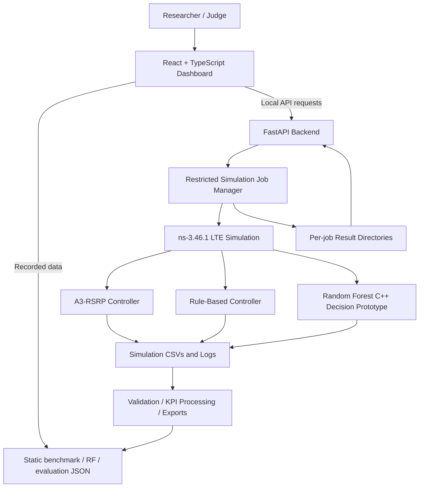

MOBI-HO Lab
Reproducible Cellular Handover Benchmarking with ns-3 LTE and Machine-Learning Integration
AIORI-3 Hackathon · Track 4: 6G & Future Networks · Problem Statement PS-016
Team: A3-PS016-TC012

[!\[Frontend\]\(https://img.shields.io/badge/Frontend-React%20%2B%20TypeScript-149eca)](frontend/)
[!\[Backend\]\(https://img.shields.io/badge/API-FastAPI-05998b)](backend/)

🎬 WATCH FINAL PROTOTYPE DEMONSTRATION
Explore the public dashboard · Level 1 proposal video · [Level 1 proposal PDF](A3-PS016-TC012.pdf)

Deployment distinction: The public Vercel website is a recorded-data demonstration. New ns-3 simulation jobs can be executed from the locally running full-stack dashboard; a public simulation server has not been deployed. The machine-learning model is an integration prototype, not an independently validated production controller.

1. Overview
MOBI-HO Lab is an end-to-end experimental environment for benchmarking cellular handover decisions under reproducible mobility conditions. It combines an ns-3 LTE simulator, three handover-controller approaches, structured trace processing, a FastAPI simulation-job API, and an interactive React dashboard.

In a cellular network, a moving user equipment (UE) may need to transition from one base station (eNB) to another. Poorly timed or unnecessary handovers can affect traffic continuity and network signaling. MOBI-HO Lab addresses a specific research and engineering need: evaluate multiple handover approaches against comparable simulations, expose the measurements, and make the results inspectable.

This repository focuses exclusively on the PS-016 cellular handover benchmarking challenge; it does not implement an unrelated home-broadband networking scenario.
Project objectives
- Simulate UE mobility and cellular handovers in a controlled three-cell LTE environment.
- Compare A3-RSRP, Rule-Based, and exploratory Random Forest handover controllers.
- Evaluate throughput, packet-reception gaps, handover events and timing, and repeatability across RNG runs.
- Preserve the simulation records that support the plotted KPIs.
- Trigger approved fresh simulations from a React frontend through a FastAPI backend.
- Make RF decisions and model-evaluation limitations transparent.
2. Demonstration and submission resources
Resource	Link / location	What it provides
Public prototype	mobi-ho-lab.vercel.app	Recorded benchmark data, charts, digital-twin replay, decision and model inspection
Final prototype demonstration	Watch on YouTube	Complete working prototype walkthrough and dashboard demonstration
Original Level 1 presentation	YouTube	Initial problem analysis and proposal
Level 1 document	[A3-PS016-TC012.pdf](A3-PS016-TC012.pdf)	Submitted concept and architecture
Detailed pipeline notes	[PIPELINE_README.md](PIPELINE_README.md)	Offline data validation, processing and comparison
Recorded benchmark artifacts		Stored results from the benchmark campaign

The final prototype demonstration is linked prominently at the top, while the original Level 1 proposal video remains available for reference.

3. System architecture

The simulation layer produces UE movement, radio measurements, handover-event logs, and traffic traces. The analysis layer computes comparable metrics and exports structured records. The API layer launches constrained local jobs. The presentation layer enables interactive inspection of both recorded and newly executed experiments.
Technology stack
Layer	Technologies	Purpose
Cellular simulation	ns-3 3.46.1, LTE/EPC, C++	Reproducible mobility and handover experimentation
Handover policies	A3-RSRP, Rule-Based, Random Forest prototype	Controller comparison
Data & model	Python, CSV/JSON, scikit-learn-related model artifacts	Processing, export and model-evaluation reporting
Backend	Python, FastAPI, Uvicorn	Read-only benchmark endpoints and simulation jobs
Frontend	React, TypeScript, Vite, Recharts, Lucide	Interactive benchmarking dashboard
Public hosting	Vercel (frontend only)	Public exploration of recorded experiments
Local development	Windows 11 + WSL2 Ubuntu	ns-3 compilation and full-stack execution

4. Dashboard workspaces
Workspace	What it does
Network Overview	Summarizes benchmark KPIs and experiment settings; explores controllers, UE speeds and RNG runs.
Benchmark Comparison	Compares throughput, reception-gap diagnostics, handover timing, run-level results and outcome distributions.
Network Digital Twin	Replays the recorded logical LTE topology with moving UE, serving-cell changes, timeline controls and component inspection. Packet-flow animations illustrate uplink/downlink directions.
Simulation Control	Submits constrained local ns-3 jobs, shows job status and displays newly returned handover events and summary counts.
Handover Events	Exposes timestamped connection, handover-start and successful-completion records.
Model Evaluation & Health	Displays RF training metrics, confusion matrix, class balance, feature ranges, implementation consistency and validation warnings.
Model & Methodology	Explains configurations, KPI definitions, experimental workflow and scope.

RF Decision Inspector is an additional analysis view for recorded RF inputs, STAY/HANDOVER recommendations, decision scores and decision distribution; it is not a separate standalone simulator. The digital-twin animation replays recorded evidence and should not be confused with a real-time browser-side network simulation.
5. Experimental design
The completed baseline campaign uses three handover controllers, two mobility speeds, and two RNG run identifiers:
Factor	Configurations
Controllers	a3 (A3-RSRP), rule (Rule-Based), ml (Random Forest)
LTE cells	3 eNBs
User equipment	1 moving UE
Speed	30 km/h, 120 km/h
RNG run	11, 12
RNG seed used by the local job launcher	1
Recorded configurations	3 × 2 × 2 = 12 runs

RNG run is the ns-3 random-number-stream run identifier. It permits repeatable sampling of modeled stochastic processes; changing the RNG run does not guarantee that every KPI will change. Two run identifiers are useful for an initial comparison but are insufficient to demonstrate statistical significance.
Controllers
1. A3-RSRP baseline: Conventional signal-measurement-driven handover reference.
2. Rule-Based: Explicit decision rules over the available measurements, providing an interpretable reference policy.
3. Random Forest prototype: Experimental decision-tree ensemble integrated into the ns-3 workflow for STAY/HANDOVER recommendations, using radio and mobility-related features and a configured score threshold.
The model's decision score is not established as a calibrated probability of handover success, and its output is not independently validated against real-world deployments.
6. Recorded benchmark results
The following values are descriptive means from the two recorded RNG runs per controller/speed. They are not confidence intervals and do not imply general performance superiority.
Controller	30 km/h — mean throughput (Mbps)	120 km/h — mean throughput (Mbps)
A3-RSRP	3.2354	3.1886
Rule-Based	3.2341	3.1715
Random Forest	3.2375	3.2350

In the recorded 120 km/h configuration, RF's mean received throughput was approximately 1.46% above A3-RSRP: (3.2350 − 3.1886) / 3.1886 × 100.

Across the 12 benchmark runs, the logged handover-event summaries contain 24 successful handovers and zero logged handover failures. This is a statement about the events recorded by these experiments—not proof of zero service failures in other scenarios or in physical networks.

The dashboard also presents reception-gap and excess-gap diagnostics, skipped packet-sequence observations, and handover completion timing. These metrics help investigate traffic continuity, but an inter-arrival gap does not by itself prove the cause of an interruption, and skipped sequence numbers are not automatically a validated end-to-end packet-loss rate.
7. Random Forest model evaluation: interpretation and limitations
The RF model artifact is designated an integration prototype / unvalidated model. Reported metrics are computed from the training observations themselves, not a held-out test set.
Training metric	Reported value
Accuracy	81.25% (13 of 16)
Balanced accuracy	90.00%
HANDOVER precision	100.00%
HANDOVER recall	80.00%
HANDOVER F1	88.89%
Brier score	0.0676

Training confusion matrix (actual class as rows; predicted class as columns; labels STAY, HANDOVER):
Actual \ Predicted	STAY	HANDOVER
STAY	1	0
HANDOVER	3	12

The training data contains 16 rows but only four unique feature vectors, with 1 STAY and 15 HANDOVER labels. Because the sample is tiny, highly imbalanced and not independently tested, 81.25% is training accuracy, not verified generalization accuracy. The exported model's JSON/reference-model consistency is a distinct engineering check; it does not replace validation on unseen mobility scenarios.

Future scientific evaluation requires larger and more diverse data, separated training/validation/test groups, robust baselines and repeatable uncertainty estimates.
8. Repository layout
A3-PS016-TC012/
├── README.md                   # Project overview (this file)
├── PIPELINE_README.md          # Offline data pipeline documentation
├── A3-PS016-TC012.pdf          # Original Level 1 proposal
├── frontend/                   # React/Vite dashboard
│   ├── src/
│   │   ├── App.tsx
│   │   └── components/
│   └── public/                 # Recorded-data JSON exports
├── backend/
│   ├── main.py                 # FastAPI application
│   └── simulation_jobs.py      # ns-3 job execution and status
├── scratch/                    # ns-3 C++ simulation/controller sources
├── models/                     # RF model artifacts and evaluation reports
├── scripts/                    # Experiment and data-export utilities
├── aiori_pipeline/             # CSV validation and KPI processing
├── configs/                    # Simulation/experiment settings
├── results/final_benchmark_v1/ # Recorded benchmark results
├── docs/                       # Technical notes
└── tests/                      # Pipeline tests
Important: The working ns-3.46.1 build is expected as a sibling directory alongside this repository, rather than bundled as a full simulator installation inside Git:
~/MOBI-HO-Lab/
├── ns-3.46.1/
└── A3-PS016-TC012/
9. Run the full prototype locally
Prerequisites
- Linux or WSL2 Ubuntu on Windows 11.
- A working ns-3.46.1 installation with the project's scratch simulation sources available in that ns-3 build.
- Node.js and npm for the Vite frontend.
- Python and a virtual environment with FastAPI/Uvicorn backend dependencies.
- Repository checkout beside the ns-3 directory, as shown above.
A Git checkout alone is not a one-command ns-3 installation: set up and build the compatible simulator, and ensure the repository's required scratch programs are present in its scratch directory. Do not confuse the scratch/ folder tracked in this repo with the simulator's active scratch/ tree.

Terminal 1 — API server
cd ~/MOBI-HO-Lab/A3-PS016-TC012
source backend/.venv/bin/activate
python -m uvicorn backend.main:app --host 127.0.0.1 --port 8000
Open the API documentation at http://127.0.0.1:8000/docs or test http://127.0.0.1:8000/api/health.

If the virtual environment is not already set up, create it and install the project's required backend packages before launching the server (at minimum FastAPI, Uvicorn and Pydantic-compatible versions).
Terminal 2 — React frontend
cd ~/MOBI-HO-Lab/A3-PS016-TC012/frontend
npm install
printf 'VITE_API_BASE_URL=http://127.0.0.1:8000\n' > .env.local
npm run dev -- --host 0.0.0.0
Open http://localhost:5173. The local .env.local is development-only and should not be committed.
Run a simulation
1. Open Simulation Control in the local dashboard.
2. Select A3-RSRP, Rule-Based, or Random Forest.
3. Select speed 30 or 120 km/h and RNG run 11 or 12.
4. Click Run Simulation and inspect the job status.
5. When complete, review the event timeline and result metrics.
The local job runner uses these programs inside ns-3: mobi-ho-integrated (A3), mobi-ho-rf (Rule-Based), and mobi-ho-rf-live (RF). Its requests are allow-listed to the three controllers and four speed/RNG combinations, with a fixed UE/eNB configuration.
API endpoints
Method	Endpoint	Purpose
GET	/api/health	API health status
GET	/api/benchmark	Recorded benchmark JSON
GET	/api/rf-decisions	Recorded RF decision data
GET	/api/scenarios	Available controllers, speeds and runs
POST	/api/jobs	Start a constrained local simulation
GET	/api/jobs/{job_id}	Poll status and retrieve the completed job result

Newly run jobs preserve artifacts under backend/job_results/<job_id>/, including CSV traces, simulation.log and result.json. The job-result directory is intentionally ignored by Git.

The simulation-job manager allows one active API simulation at a time because ns-3 currently writes shared fixed output filenames. It is a local development orchestrator, not a hardened public multi-tenant simulation service.
10. Recorded-data pipeline and exports
The repository includes a separate offline data-processing workflow that validates inputs, builds timestamp-safe radio/mobility features, computes run KPIs, and compares recorded results. See [PIPELINE_README.md](PIPELINE_README.md) for the precise pipeline commands and metric semantics.

The dashboard's recorded-data mode loads the exported files in frontend/public/, including benchmark.json, rf_decisions.json and model_evaluation.json. This makes the public frontend useful even when the simulation backend is offline.

Do not merge new ad hoc local-job outputs into the official benchmark summaries without validating them and re-running the intended data-processing/export workflow. This keeps reported comparisons reproducible.
11. Deployment and security
- Public deployment: MOBI-HO Lab on Vercel provides the frontend and recorded experiments only.
- Local live stack: React → FastAPI → ns-3 C++ simulation, running on a controlled development machine.
- Production limitation: The ns-3 executable, its C++ dependencies, process/job isolation and hosting are not deployed on Vercel. The public Run Simulation control cannot execute a new server-side ns-3 job.
- Security limitation: The current local simulation endpoint is not authenticated; the job runner also relies on process-local locking and shared simulator output filenames. Do not expose the local API directly to the public internet. Public simulation hosting would require authentication, quotas, request limits, sandboxed jobs, robust output isolation, monitoring and HTTPS.
To publish frontend changes through the existing manually linked Vercel CLI project:
cd ~/MOBI-HO-Lab/A3-PS016-TC012/frontend
vercel --prod
Ensure production builds do not embed VITE_API_BASE_URL=http://127.0.0.1:8000. The public website should use recorded-data mode unless a secure publicly hosted API is available.
12. Practical applications
- Telecom R&D: Evaluate candidate handover policies against consistent LTE simulation configurations.
- High-mobility studies: Investigate controller behavior at different UE speeds and packet-reception patterns.
- Pre-deployment screening: Identify promising or problematic behavior before costlier physical trials.
- Explainable ML experimentation: Inspect model inputs, scores and decisions alongside network events.
- Teaching and research: Demonstrate LTE topology, mobility events, KPI computation and experimental repeatability.
This is a simulation-based research prototype. It does not currently operate on live cellular base stations, constitute production 5G/6G infrastructure, or establish field-performance gains.
13. Limitations and roadmap
Currently demonstrated	Next validation / engineering step
Three-cell LTE scenario with one moving UE	More UEs, layouts, mobility patterns and radio conditions
12 runs with two RNG identifiers per condition	More repetitions, uncertainty estimates and scenario sweeps
RF prototype integrated into simulation	Larger balanced dataset and independent, group-separated testing
Recorded packet-reception and handover diagnostics	Stronger interruption and service-failure attribution
Local FastAPI job execution	Hardened isolated cloud simulation service
Public recorded-data dashboard	Optional authenticated cloud-backed live simulation
LTE experimental foundation	Future 5G NR benchmarking where simulator support permits

14. Team and acknowledgments
Team ID: A3-PS016-TC012
Hackathon: AIORI-3 · Track 4 — 6G & Future Networks
Challenge: PS-016 — Simulation-Based Handover Decision Evaluation for High-Mobility Users

Team members
- Joe Francis Sebastian — joe.francis@btech.christuniversity.in
- Debayan Ghose — debayan.ghose@btech.christuniversity.in
Mentor
- Dr. Shamanth N — shamanth.nagaraju@christuniversity.in
We thank our mentor and the AIORI-3 organizers for their guidance and the opportunity to develop this proof of concept.
15. References
- ns-3 Network Simulator
- ns-3 LTE model documentation
- RFC 2330 — Framework for IP Performance Metrics
- [Project-specific offline pipeline documentation](PIPELINE_README.md)

MOBI-HO Lab — Turning Cellular Handover Decisions into Measurable Engineering Evidence.
